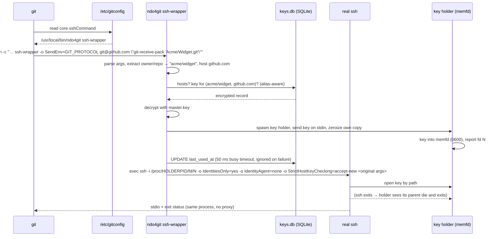

# ndo4git

**One SSH key per repository, picked automatically by `git`.** No `~/.ssh/config` aliases, no
rewritten remotes, no agent. You clone, pull and push exactly as before; ndo4git works out which
repository git is talking to and hands ssh that repository's own key.

Works with **GitHub**, **Codeberg / Forgejo / Gitea** and **GitLab** (nested groups and self-hosted
instances included). Keys are generated in-process, stored encrypted in a local SQLite database, and
never written to disk in the clear. Linux and macOS.

```sh
sudo ndo4git install                  # once per machine
cd my-clone && ndo4git new            # prints a public key and where to paste it (deploy key page)
git pull                              # that's it: git now uses a key that only this repo accepts
```

## Why use it

**The problem.** The usual setup is one personal SSH key that can reach *everything* you can reach.
That key sits on every laptop, build server and container that needs to clone a private repo.
If any of them leaks it, every repository (and every organisation) you belong to is exposed.

The safe alternative is a **deploy key per repository**: a key that is only valid for one repo, and
can be read-only. GitHub even forces this shape: *a deploy key can be added to one repository only*.
But plain git/ssh makes that painful. You need a `Host` alias and an `IdentityFile` entry per repo in
`~/.ssh/config`, and you must rewrite every remote to `git@gh-myrepo:owner/repo.git`. Submodules,
copy-pasted clone URLs, tools that run `git clone git@github.com:owner/repo.git` and CI scripts all
break, and the key files lie around in `~/.ssh`.

**What ndo4git does about it.** It plugs into git's own `core.sshCommand` hook. On every SSH call it
reads the repository path git is asking for (`git-upload-pack 'owner/repo.git'`), looks up the key for
exactly that repo and runs the real `ssh` with it. Remote URLs stay normal. If anything is unknown or
goes wrong it steps aside and runs plain `ssh` with your original arguments, so it can never lock you
out of a repository it does not manage.

**Why that is useful**

| You are… | What you get |
|---|---|
| a developer with many private repos | one key per repo with zero config; a leaked laptop key exposes one repo, not your whole account |
| running servers, CI or containers | give each machine its own deploy key (read-only if you tick that box on the forge) for just the repos it needs; rotate one key without touching the rest (`new --rotate`) |
| working across accounts (work / personal / OSS) | the right commit **identity** (name, e-mail, SSH signing key) is applied per remote automatically, and `whoami` proves git is using it |
| building tools or letting automation drive git | a single declarative `manifest.toml` with `plan` / `apply` / `rollback`, JSON output on every command and a machine-readable `schema` |
| security-minded | keys encrypted at rest (XChaCha20-Poly1305), handed to ssh through an anonymous memory file (never argv, env or a named file), no `unsafe` code |
| performance-minded | the wrapper starts in about 2 ms, nothing runs in the background, and an optional `perf` preset makes everyday git commands a little faster |

**How it compares**

| Approach | Per-repo keys | Normal remote URLs | Works for submodules / CI scripts | Keys encrypted at rest |
|---|---|---|---|---|
| one personal key + ssh-agent | no | yes | yes | depends |
| `~/.ssh/config` host aliases | yes | **no** (remotes rewritten) | **no** | no (plain files) |
| `core.sshCommand` per clone (`-i key`) | yes | yes | partly (set per repo) | no |
| **ndo4git** | **yes** | **yes** | **yes** | **yes** |

## What is in the box

* **Transparent per-repo SSH keys** (ed25519 generated in-process; no `ssh-keygen`, no agent).
* **One tool for every forge**: GitHub, Codeberg (Forgejo/Gitea), GitLab incl. subgroups, plus self-hosted via `host add`.
* **Fail-open wrapper**: anything unexpected runs plain `ssh` with your original arguments.
* **Manifest with `plan` / `apply` / `rollback`**: hosts, keys, aliases, git identities and settings from one file, with drift checks for scripts (`plan --check`).
* **Per-repository git identities** applied by git itself (`includeIf`), optionally with SSH commit signing.
* **`git` shim**: `install` puts a `git` symlink in front of the real one that just `exec`s it (≈1 ms, no proxy process). `install` refuses to run when git is missing.
* **Encrypted backup / restore**, key rotation with history, rename aliases, export, import.
* **Automation friendly**: `--json`, stable exit codes, no prompts, `ndo4git schema`.
* **Linux and macOS only** (no Windows). Linux: x86_64 and aarch64, static musl binary for any distro, `.deb` for Debian/Ubuntu. macOS: Apple Silicon and Intel. MSRV: Rust 1.85 (declared; only verified on current stable).

## Install

Every [release](https://github.com/NDO4ME/NDO4Git/releases) carries these files and a `SHA256SUMS` list (`sha256sum -c SHA256SUMS`):

| Platform | Asset |
|---|---|
| Debian / Ubuntu (all releases) | `ndo4git_<version>_amd64.deb`, `ndo4git_<version>_arm64.deb` |
| Any Linux, static | `ndo4git-x86_64-linux-musl`, `ndo4git-aarch64-linux-musl` |
| macOS | `ndo4git-aarch64-apple-darwin` (Apple Silicon), `ndo4git-x86_64-apple-darwin` (Intel) |

```sh
# Debian / Ubuntu: installs /usr/bin/ndo4git and configures git (postinst runs `ndo4git install`)
sudo apt install ./ndo4git_<version>_amd64.deb

# any Linux / macOS: download the binary for your platform, then
chmod +x ndo4git-*; sudo ./ndo4git-<arch>-<os> install
```

From source: `cargo build --release --target x86_64-unknown-linux-musl`, then `sudo ./target/…/ndo4git install`.
The .deb has no library dependencies (the binary is static); it needs `git` and `openssh-client`.
When ndo4git runs from `/usr/bin` (the .deb) `install` only configures git and retires an older
`/usr/local/bin` copy; the package keeps owning the binary.

Re-run `sudo ndo4git install` after upgrading a manually installed binary to replace the installed copy.

`install` (root only, idempotent) first checks that **git is installed**. If it is not, nothing is
changed and the command tells you how to install it (`sudo apt install git`, `brew install git`, …).
Then it copies the binary to `/usr/local/bin/ndo4git` (temp file + rename, 0755), links
`/usr/local/bin/git-ndo4git` and the **`git` shim** `/usr/local/bin/git`, and runs
`git config --system core.sshCommand "/usr/local/bin/ndo4git ssh-wrapper"`.
Any previous system value is saved in `/etc/ndo4git/previous_sshcommand`.

The shim is a symlink to the ndo4git binary. When the binary starts under the name `git` it looks
the real git up in `PATH` (skipping itself and relative entries) and `exec`s it with the original
arguments; exit status, stdio and signals are untouched. A `/usr/local/bin/git` that is not ours
(for example a git built from source) is never replaced or removed. `/usr/local/bin` must come
before the real git in `PATH`, which is the default on Linux and on Intel macOS; with Homebrew on
Apple Silicon put it before `/opt/homebrew/bin`. If `PATH` is empty or holds only the shim (cron, IDEs, `env -i`), the shim also tries `/usr/bin`, `/bin` and the Homebrew/Xcode locations, and it stops with a clear error instead of looping when two copies call each other. Key selection itself stays in
`core.sshCommand`, so programs that call `/usr/bin/git` by absolute path still get the right key.

Removing the `.deb` (`apt remove ndo4git`) restores the previous value automatically; user data is kept.

## Use

```sh
cd my-clone && ndo4git new            # key for origin (any supported host)
ndo4git new acme/widget       # GitHub
ndo4git new git@github.com:NDO4ME/NDO4Git.git
ndo4git new git@gitlab.com:group/sub/project.git
ndo4git new gitlab.example.org/team/proj   # HOST/PATH, after `host add` (see below)
```

Prints exactly:

```
Repo:        acme/widget
Fingerprint: SHA256:...
Add this public key at:
https://github.com/acme/widget/settings/keys/new

ssh-ed25519 AAAA... ndo4git:acme/widget@hostname
```

The settings page depends on the forge:

| Forge | Default hosts | Deploy-key page |
|---|---|---|
| GitHub | `github.com` (Enterprise: `host add`) | `https://HOST/OWNER/REPO/settings/keys/new` |
| Forgejo / Gitea | `codeberg.org` | `https://HOST/OWNER/REPO/settings/keys` |
| GitLab | `gitlab.com` | `https://HOST/GROUP/SUB/PROJECT/-/settings/repository#js-deploy-keys-settings` |

`github.com`, `codeberg.org` and `gitlab.com` are managed out of the box. For
any other host run `ndo4git host add git.example.org [--forge github|gitlab|forgejo]`
(the forge kind is guessed from the name when omitted; unknown names count as GitHub Enterprise).
Keys are stored per `(path, host)`, so the same path on two forges gets two keys.

Paste the key into that page; from then on git just works. If a key exists,
`new` prints it and exits with status 2 unless `--rotate` is given (the old
public key goes to `key_history`).

| Command | Purpose |
|---|---|
| `new [target] [--rotate] [--comment S] [--json]` | generate a key (`target`: `OWNER/REPO`, `GROUP/SUB/PROJECT`, `HOST/PATH`, or a clone URL; `--host H` for bare paths) |
| `list [--json]`, `show <repo>`, `rm <repo>` | inspect / delete |
| `import <repo> <file\|->  [--force]` | store an existing unencrypted OpenSSH key |
| `init [--force]` | write a starter manifest that reproduces the current state |
| `plan [--check] [--json]` | show what `apply` would change; `--check` exits 2 on drift |
| `apply`, `rollback` | reconcile reality with the manifest; undo the last `apply` |
| `whoami [target]` | which manifest identity applies to a repo, and does git actually use it |
| `export-pub <repo>`, `export-private <repo> --yes` | the only ways keys leave the DB |
| `alias <old> <new> [--remove]` | renamed/transferred repo: `old` uses `new`'s key |
| `host list\|add\|rm <host> [--forge K]` | hosts the wrapper acts on (default `github.com`, `codeberg.org`, `gitlab.com`) |
| `backup <file>` / `restore <file> [--overwrite]` | Argon2id + XChaCha20-Poly1305 encrypted; passphrase via prompt, `NDO4GIT_BACKUP_PASSPHRASE`, or `--passphrase-file` |
| `completions <shell>`, `man` | completion scripts / man page (`scripts/gen-assets.sh`) |

Global: `--manifest FILE` (or `NDO4GIT_MANIFEST`), `--host HOST`, `--sudo-user-home` (root running under sudo uses `$SUDO_USER`'s data; for the wrapper set `NDO4GIT_SUDO_USER_HOME=1`).

Environment: `NDO4GIT_DEBUG=1` (wrapper logs to stderr), `NDO4GIT_SSH=/path/to/ssh`, `XDG_CONFIG_HOME`.

Data: `~/.config/ndo4git/` (0700) with `keys.db` and `master.key` (0600). The
home directory comes from the passwd entry of the effective uid, not `$HOME`
(falls back to `$HOME` only when there is no passwd entry, e.g. containers).
Modes are checked and repaired on every start; wrong ownership or symlinks are refused.

Publishing a release (maintainers): bump `version` in `Cargo.toml`, add a `## X.Y.Z` section to
`CHANGELOG.md`, commit, then `git tag vX.Y.Z && git push origin vX.Y.Z`. The release workflow does the
rest (see Development); nothing is built or signed on a personal machine.

## Manifest, plan and apply

`~/.config/ndo4git/manifest.toml` is the single source of truth. Everything else (the database
rows, generated git config) is derived from it. Start with `ndo4git init`, which writes a manifest
that matches your current setup, so `ndo4git plan` starts out empty.

```toml
version = 1
perf = true             # performance preset, see below
prune = false           # true: also remove hosts/aliases that are not listed (keys are never deleted)
hostkey = "accept-new"  # accept-new | ask | strict
keys = ["acme/widget", "git.example.org/team/proj"]   # must have a key; created by `apply`

[hosts]
"git.example.org" = "gitlab"       # github | gitlab | forgejo

[aliases]
"acme/old-name" = "acme/widget"

[settings]                         # allow-listed performance/workflow keys only
"pull.rebase" = "true"

[[identity]]                       # later entries win, like git's includeIf
id = "work"
name = "Ada Lovelace"
email = "ada@acme.example"
signing_key = "~/.ssh/id_ed25519.pub"   # optional: sign commits with SSH
match = ["github.com/acme/*"]
```

```
$ ndo4git plan
+ host git.example.org (gitlab)
+ key acme/widget on github.com
+ file derived/main.gitconfig
+ ~/.gitconfig include.path = /home/me/.config/ndo4git/derived/main.gitconfig
4 change(s) pending; run `ndo4git apply`
```

* `plan` changes nothing. `plan --check` exits 2 when reality differs (for scripts).
* `apply` executes the plan in a safe order (the git include is added last and removed first) and
  prints the public key of every key it created. Every step is journaled in `last-apply.json`;
  if a step fails the earlier ones stay journaled too.
* `rollback` undoes the last `apply` (one level). A key created by `apply` is deleted again, unless it has been used since (it is then kept and reported). The journal is validated before anything is undone, and `apply`/`rollback` hold a lock so two runs cannot interleave.
* Identities are plain git config: `apply` writes `derived/main.gitconfig` with `includeIf
  "hasconfig:remote.*.url:…"` rules (needs git ≥ 2.36) and adds one `include.path` line to your
  global gitconfig. Git evaluates them itself, so they cost no process time. Patterns cover
  `git@host:path`, `ssh://`, `https://` (with or without user and `.git`) and ignore letter case.
  `ndo4git whoami` shows the identity for the current repository and fails when git uses another.
* `perf = true` sets: `ssh.variant=ssh` (saves the extra `ssh -G` probe on every git command),
  `fetch.parallel=0`, `fetch.writeCommitGraph`, `feature.manyFiles`, `pack.threads=0`,
  `gc.auto=6700`, `maintenance.auto`, `protocol.version=2`, `fetch.negotiationAlgorithm=skipping`.
  No daemons (no fsmonitor), nothing that grows memory or disk use.
* The manifest cannot set anything that runs a program (`core.sshCommand`, `core.fsmonitor`,
  `core.hooksPath`, `alias.*`, `credential.*`, `filter.*`, …): unknown or non-allow-listed keys
  are rejected, as are control characters in any value.

## Automation and scripting

* `ndo4git schema` prints every command, option, exit code and environment variable as JSON (generated from the real CLI definitions, so it cannot drift).
* `--json` is available on `new`, `list`, `show`, `plan`, `apply`, `rollback`, `whoami` and `host list`. JSON goes to stdout only; errors and hints go to stderr.
* Exit status: `0` success, `1` error, `2` key already exists (`new`) or changes pending (`plan --check`).
* Nothing prompts unless a backup passphrase is needed; `NDO4GIT_BACKUP_PASSPHRASE` or `--passphrase-file` keeps it non-interactive.
* `plan` is read-only, `apply` is idempotent, `rollback` undoes the last `apply`. Use `--manifest` and `XDG_CONFIG_HOME` to work in an isolated directory.
* Contributor and tooling notes: [`AGENTS.md`](AGENTS.md).

## Architecture

```
crates/
  ndo4git-core/         library (all logic, all unit tests)
    repo.rs             normalize_repo() – the ONE name validator; remote URL parsing
    wrapper.rs          pure ssh-argv + remote-command parsing (table tests + proptest)
    exec.rs             hot path: lookup → key holder (memfd) → exec ssh
    forge.rs            GitHub / Forgejo / GitLab differences (deploy-key URLs)
    db.rs + migrations/ rusqlite, WAL, PRAGMA user_version migrations, FK on
    crypto.rs           master key, XChaCha20-Poly1305 records, passphrase blobs
    keygen.rs           ed25519 generate / import (ssh-key crate)
    manifest.rs plan.rs  TOML manifest; plan/apply/rollback (pure diff + journal)
    gitshim.rs          the `git` symlink: find real git, exec it
    backup.rs install.rs paths.rs util.rs error.rs
  ndo4git/              thin bin: clap CLI, rendering, passphrase prompt
```

`main()` special-cases `argv[1] == "ssh-wrapper"` before clap is constructed, so
the hot path does no argument-framework setup. Measured overhead on a laptop
(musl release, wrapper vs. bare script): ≈1.5 ms.

### One `git push`



No key / unparsable / any error → `exec ssh <original args>` unchanged.

### Wrapper argv contract

Input is everything after `ssh-wrapper`, shaped like ssh's own command line:
options (clustered short flags, `-p22`/`-p 22`, `-o Port=22`, `-oPort 22`, `-l`, `-4/-6/-T/…`),
then a destination (`host`, `user@host`, `ssh://user@host:port`), then the remote
command words (joined by spaces, as ssh does). Options after the host are parsed too; `--` ends options.
`-G`, `-V`, `-Q`, `-O` mark a probe and are never managed (git itself runs `ssh -G variant-test-host`
to auto-detect the ssh flavour; that call reaches the real ssh untouched — covered by the integration test that uses real git).
Unknown options, bad ports, missing values → not managed.

Managed remote commands: `git-upload-pack`, `git-receive-pack`, `git-upload-archive`
(also `git upload-pack …` and absolute paths), plus `git-lfs-authenticate` / `git-lfs-transfer`
(`'path' upload|download`). Exactly one path; quotes `'…'`, `"…"`, bare, `'\''` escapes,
leading `/`, trailing `/` and `.git`, any case. The path must pass `normalize_repo`
(2 to 10 components of `[A-Za-z0-9._-]+`; `..`, leading `-`, NUL, newlines rejected).

### Key hand-off (why a holder process)

OpenSSH calls `closefrom()` at startup, so a descriptor inherited across `exec`
(`-i /proc/self/fd/N`) no longer exists when ssh goes to read the key. The wrapper therefore
starts `ndo4git __key-holder` (own process group), sends it the decrypted key on stdin and
zeroizes its copy. The holder puts the key in an anonymous `memfd` (0600; fallback: a 0600
file in `$XDG_RUNTIME_DIR`/`/dev/shm`/`/tmp`, unlinked immediately) and waits. The wrapper
then `exec`s ssh with `-i /proc/<holder pid>/fd/N`. Because `exec` keeps the pid, the holder's
parent *is* ssh, and the holder exits when ssh does (`PR_SET_PDEATHSIG` plus a 250 ms
parent check). git still sees a plain ssh process: exit status and stdio pass through.
This is covered by a test that runs the real OpenSSH client and checks it parsed the key.

### Edge cases

* **Submodules**: each is a separate ssh invocation with its own repo path → its own key.
* **`ssh://…:port`, `-p`**: ports never affect lookup; the original args are passed through.
* **Other hosts / self-hosted**: `ndo4git host add ghe.corp [--forge …]`, then `ndo4git new ghe.corp/o/r`. Keys are per `(repo, host)`.
* **GitLab subgroups**: paths with 2 to 10 components (`group/sub/sub2/project`) are accepted. A first segment containing a dot is read as a host in `HOST/PATH` targets.
* **Rename/transfer**: `ndo4git alias old/name new/name`.
* **Concurrency**: WAL; hot path takes read locks and one rate-limited (≤1/min/key) write with a 50 ms timeout.
* **sudo git**: root uses root's data directory. `--sudo-user-home` / `NDO4GIT_SUDO_USER_HOME=1` opt in to `$SUDO_USER`'s.
* **CI/containers without HOME**: passwd lookup, then `$HOME`, then `XDG_CONFIG_HOME`; if none, the wrapper fails open.

## Security model

Protects against: other local users and backups/disk images reading private keys
(records are XChaCha20-Poly1305 with a random 24-byte nonce, AAD binds repo/host/algo so rows can't be swapped;
`master.key` is 0600, created with a temp-file + hard-link so it is race-free and never clobbered);
key leakage via argv/env (key goes through an anonymous memfd, never a named file);
shell injection (no shell strings anywhere, argv arrays only; repo names validated by one function).
Secrets are held in `zeroize`/`secrecy` types and wiped before `exec`.

Does **not** protect against: root, or any process running as the same user (it can read
`master.key` and the DB, or `/proc/<pid>/fd` of a running ssh). The master key sits next to the
database — an attacker with the whole directory gets the keys, by design: git runs
non-interactively so there is no passphrase. Mitigations: keep the directory 0700, use
GitHub **deploy keys** (per repository, ideally read-only), and encrypt your disk.
Server host keys: by default `StrictHostKeyChecking=accept-new` (trust on first use, reject any
later change). Tighten it with `ndo4git host hostkey strict` (only hosts already in `known_hosts`
are accepted) or `ask` (ndo4git passes no option; ssh's own default applies). The policy applies to
managed calls only and is stored in the database.

`unsafe`: none in this workspace (`#![forbid(unsafe_code)]`). `memfd_create`/`execv` go through `nix`'s safe API.

## Limitations

* The aarch64 Linux and both macOS binaries are cross-compiled and link cleanly (the arm64 macOS one carries an ad-hoc code signature), but they have **not been run on real hardware**; the test suite runs on x86_64 Linux only. On macOS the key is staged in a 0600 file in a private 0700 directory (no `memfd`/`/proc`) for the lifetime of the ssh process instead of an anonymous memory file; that path is exercised on Linux via `NDO4GIT_KEY_STAGING=file`.
* macOS: `install` runs `git config --system` for the first `git` on `PATH`; Apple's and Homebrew's git read different system files, so run it with the git you actually use.
* Bitbucket and other forges are not special-cased (unknown hosts behave like GitHub Enterprise); the SSH transport works, but the printed settings URL may not exist.
* Only `ssh-ed25519` can be generated; `import` accepts what the `ssh-key` crate build here supports (ed25519), unencrypted.
* Hosts are matched literally on the destination given to ssh. A `Host alias` in `~/.ssh/config` (e.g. `git@gh-work:o/r`) is **not** resolved; use real host names (or `insteadOf`).
* A global/local `core.sshCommand` or `GIT_SSH_COMMAND` overrides the system setting.
* OS keyring support is not implemented; the master key is a file.
* With `core.sshCommand`, git probes the variant with `ssh -G`, costing one extra ssh start per git command; `perf = true` in the manifest (or `git config --system ssh.variant ssh`) avoids it.
* The `git` shim adds one process start (about 1 ms with a glibc build on a laptop; less with the static musl binary) to every git command. It is a plain `exec`, not a proxy: no extra process stays alive.
* `includeIf` identities need git ≥ 2.36 (`hasconfig`); `apply` uses `git config --fixed-value` (git ≥ 2.30).
* Windows is not supported.
* The Linux fallback path (no `memfd_create`) unlinks the temp file immediately; the holder's open descriptor keeps it alive. The key is readable through `/proc/<holder pid>/fd` only by the same user (or root). With file staging (macOS) the file exists on disk (0600, private directory) until ssh exits; a hard-killed holder leaves it behind until the next run sweeps files older than a day.
* Wrapper `last_used_at` is best effort and rate limited.
* `cargo-deny`/`cargo audit` configs: two advisories are ignored because they concern optional `ssh-key` features that are not compiled (`cargo tree -i rsa` is empty).

## License

MIT, see `LICENSE`.

## Development

```sh
cargo fmt --all && cargo clippy --workspace --all-targets -- -D warnings && cargo test --workspace
cargo audit && cargo deny check                # configs: .cargo/audit.toml, deny.toml
scripts/gen-assets.sh target/release/ndo4git   # man page + completions → target/assets
scripts/build-deb.sh BINARY amd64|arm64 OUT.deb # needs dpkg-deb; postinst runs `ndo4git install`
git tag vX.Y.Z && git push origin vX.Y.Z        # release workflow: 4 binaries + 2 .deb + SHA256SUMS
```

CI (`.github/workflows/ci.yml`) runs them on one Linux VM and cross-builds Linux (static musl) and macOS binaries for x86_64 and aarch64. Pushing a tag `vX.Y.Z` that matches `Cargo.toml` runs `.github/workflows/release.yml`: one job tests, cross-builds the four binaries and the `.deb` packages from source, writes `SHA256SUMS` and publishes the GitHub release. Release builds contain no runner paths or user names.

Integration tests (`crates/ndo4git/tests/integration.rs`) run the real binary with a temp
`XDG_CONFIG_HOME` and a fake `ssh` on `PATH` that records its argv and the key it was handed;
one test drives real `git ls-remote` through the wrapper, one runs the real OpenSSH client to
check it can load the key.
