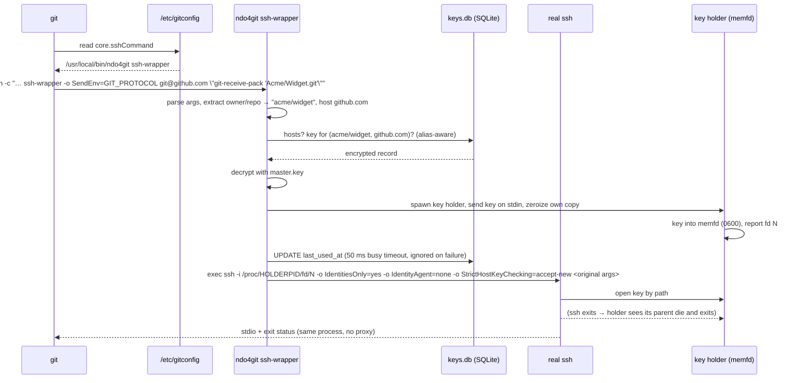

# ndo4git

Transparent **per-repository SSH keys** for `git` over SSH, for **GitHub**,
**Codeberg / Forgejo / Gitea** and **GitLab** (including nested groups and
self-hosted instances). Install once, add the generated public key as a deploy
key, and `git push/pull/fetch/clone` pick the right key automatically. Keys live encrypted in a local SQLite database.

* Single static binary (`ndo4git`, also reachable as `git ndo4git`).
* One tool for every forge: GitHub, Codeberg (Forgejo/Gitea), GitLab incl. subgroups.
* No `ssh-keygen`, no agent, no `~/.ssh/config` games: key generation is in-process (ed25519).
* Fails open: anything unexpected → plain `ssh` runs with your original arguments.
* Linux only (uses `memfd_create` and `/proc/self/fd`). MSRV: Rust 1.85 (declared; CI runs a 1.85 `cargo check`, local verification was on stable only).

## Install

```sh
cargo build --release --target x86_64-unknown-linux-musl   # or download a release / .deb
sudo ./target/x86_64-unknown-linux-musl/release/ndo4git install
```

Re-run `sudo ndo4git install` after upgrading to replace the installed binary.

`install` (root only, idempotent) copies the binary to `/usr/local/bin/ndo4git`
(temp file + rename, 0755), links `/usr/local/bin/git-ndo4git`, and runs
`git config --system core.sshCommand "/usr/local/bin/ndo4git ssh-wrapper"`.
Any previous system value is saved in `/etc/ndo4git/previous_sshcommand`.

`sudo ndo4git uninstall` reverses all of it and restores the previous value.
User data is only removed with `--purge`.

## Use

```sh
cd my-clone && ndo4git new            # key for origin (any supported host)
ndo4git new acme/widget --write       # GitHub; remember "write access"
ndo4git new ssh://git@codeberg.org/NDO4ME/git.git
ndo4git new git@gitlab.com:group/sub/project.git
ndo4git new gitlab.example.org/team/proj   # HOST/PATH, after `host add` (see below)
```

Prints exactly:

```
Repo:        acme/widget
Fingerprint: SHA256:...
Add this public key at:
https://github.com/acme/widget/settings/keys/new
(Allow write access: yes)

ssh-ed25519 AAAA... ndo4git:acme/widget@hostname
```

The settings page depends on the forge:

| Forge | Default hosts | Deploy-key page |
|---|---|---|
| GitHub | `github.com` (Enterprise: `host add`) | `https://HOST/OWNER/REPO/settings/keys/new` |
| Forgejo / Gitea | `codeberg.org` | `https://HOST/OWNER/REPO/settings/keys` |
| GitLab | `gitlab.com` | `https://HOST/GROUP/SUB/PROJECT/-/settings/repository#js-deploy-keys-settings` |

`github.com`, `codeberg.org` and `gitlab.com` are managed out of the box. For
any other host run `ndo4git host add git.example.org [--forge github|gitlab|forgejo]`
(the forge kind is guessed from the name when omitted; unknown names count as GitHub Enterprise).
Keys are stored per `(path, host)`, so the same path on two forges gets two keys.

Paste the key into that page; from then on git just works. If a key exists,
`new` prints it and exits with status 2 unless `--rotate` is given (the old
public key goes to `key_history`).

| Command | Purpose |
|---|---|
| `new [target] [--rotate] [--write] [--comment S] [--json]` | generate a key (`target`: `OWNER/REPO`, `GROUP/SUB/PROJECT`, `HOST/PATH`, or a clone URL; `--host H` for bare paths) |
| `list [--json]`, `show <repo>`, `rm <repo>` | inspect / delete |
| `import <repo> <file\|->  [--force]` | store an existing unencrypted OpenSSH key |
| `export-pub <repo>`, `export-private <repo> --yes` | the only ways keys leave the DB |
| `alias <old> <new> [--remove]` | renamed/transferred repo: `old` uses `new`'s key |
| `host list\|add\|rm <host> [--forge K]` | hosts the wrapper acts on (default `github.com`, `codeberg.org`, `gitlab.com`) |
| `doctor [--json]` | install, `/etc/gitconfig`, real ssh, perms, `integrity_check`, overrides |
| `backup <file>` / `restore <file> [--overwrite]` | Argon2id + XChaCha20-Poly1305 encrypted; passphrase via prompt, `NDO4GIT_BACKUP_PASSPHRASE`, or `--passphrase-file` |
| `completions <shell>`, `man` | completion scripts / man page (`scripts/gen-assets.sh`) |

Global: `--host HOST`, `--sudo-user-home` (root running under sudo uses `$SUDO_USER`'s data; for the wrapper set `NDO4GIT_SUDO_USER_HOME=1`).

Environment: `NDO4GIT_DEBUG=1` (wrapper logs to stderr), `NDO4GIT_SSH=/path/to/ssh`, `XDG_CONFIG_HOME`.

Data: `~/.config/ndo4git/` (0700) with `keys.db` and `master.key` (0600). The
home directory comes from the passwd entry of the effective uid, not `$HOME`
(falls back to `$HOME` only when there is no passwd entry, e.g. containers).
Modes are checked and repaired on every start; wrong ownership or symlinks are refused.

## Architecture

```
crates/
  ndo4git-core/         library (all logic, all unit tests)
    repo.rs             normalize_repo() – the ONE name validator; remote URL parsing
    wrapper.rs          pure ssh-argv + remote-command parsing (table tests + proptest)
    exec.rs             hot path: lookup → key holder (memfd) → exec ssh
    forge.rs            GitHub / Forgejo / GitLab differences (deploy-key URLs)
    db.rs + migrations/ rusqlite, WAL, PRAGMA user_version migrations, FK on
    crypto.rs           master key, XChaCha20-Poly1305 records, passphrase blobs
    keygen.rs           ed25519 generate / import (ssh-key crate)
    backup.rs install.rs doctor.rs paths.rs util.rs error.rs
  ndo4git/              thin bin: clap CLI, rendering, passphrase prompt
```

`main()` special-cases `argv[1] == "ssh-wrapper"` before clap is constructed, so
the hot path does no argument-framework setup. Measured overhead on a laptop
(musl release, wrapper vs. bare script): ≈1.5 ms.

### One `git push`



No key / unparsable / any error → `exec ssh <original args>` unchanged.

### Wrapper argv contract

Input is everything after `ssh-wrapper`, shaped like ssh's own command line:
options (clustered short flags, `-p22`/`-p 22`, `-o Port=22`, `-oPort 22`, `-l`, `-4/-6/-T/…`),
then a destination (`host`, `user@host`, `ssh://user@host:port`), then the remote
command words (joined by spaces, as ssh does). Options after the host are parsed too; `--` ends options.
`-G`, `-V`, `-Q`, `-O` mark a probe and are never managed (git itself runs `ssh -G variant-test-host`
to auto-detect the ssh flavour; that call reaches the real ssh untouched — covered by the integration test that uses real git).
Unknown options, bad ports, missing values → not managed.

Managed remote commands: `git-upload-pack`, `git-receive-pack`, `git-upload-archive`
(also `git upload-pack …` and absolute paths), plus `git-lfs-authenticate` / `git-lfs-transfer`
(`'path' upload|download`). Exactly one path; quotes `'…'`, `"…"`, bare, `'\''` escapes,
leading `/`, trailing `/` and `.git`, any case. The path must pass `normalize_repo`
(2 to 10 components of `[A-Za-z0-9._-]+`; `..`, leading `-`, NUL, newlines rejected).

### Key hand-off (why a holder process)

OpenSSH calls `closefrom()` at startup, so a descriptor inherited across `exec`
(`-i /proc/self/fd/N`) no longer exists when ssh goes to read the key. The wrapper therefore
starts `ndo4git __key-holder` (own process group), sends it the decrypted key on stdin and
zeroizes its copy. The holder puts the key in an anonymous `memfd` (0600; fallback: a 0600
file in `$XDG_RUNTIME_DIR`/`/dev/shm`/`/tmp`, unlinked immediately) and waits. The wrapper
then `exec`s ssh with `-i /proc/<holder pid>/fd/N`. Because `exec` keeps the pid, the holder's
parent *is* ssh, and the holder exits when ssh does (`PR_SET_PDEATHSIG` plus a 250 ms
parent check). git still sees a plain ssh process: exit status and stdio pass through.
This is covered by a test that runs the real OpenSSH client and checks it parsed the key.

### Edge cases

* **Submodules**: each is a separate ssh invocation with its own repo path → its own key.
* **`ssh://…:port`, `-p`**: ports never affect lookup; the original args are passed through.
* **Other hosts / self-hosted**: `ndo4git host add ghe.corp [--forge …]`, then `ndo4git new ghe.corp/o/r`. Keys are per `(repo, host)`.
* **GitLab subgroups**: paths with 2 to 10 components (`group/sub/sub2/project`) are accepted. A first segment containing a dot is read as a host in `HOST/PATH` targets.
* **Rename/transfer**: `ndo4git alias old/name new/name`.
* **Concurrency**: WAL; hot path takes read locks and one rate-limited (≤1/min/key) write with a 50 ms timeout.
* **sudo git**: root uses root's data directory. `--sudo-user-home` / `NDO4GIT_SUDO_USER_HOME=1` opt in to `$SUDO_USER`'s.
* **CI/containers without HOME**: passwd lookup, then `$HOME`, then `XDG_CONFIG_HOME`; if none, the wrapper fails open.

## Security model

Protects against: other local users and backups/disk images reading private keys
(records are XChaCha20-Poly1305 with a random 24-byte nonce, AAD binds repo/host/algo so rows can't be swapped;
`master.key` is 0600, created with a temp-file + hard-link so it is race-free and never clobbered);
key leakage via argv/env (key goes through an anonymous memfd, never a named file);
shell injection (no shell strings anywhere, argv arrays only; repo names validated by one function).
Secrets are held in `zeroize`/`secrecy` types and wiped before `exec`.

Does **not** protect against: root, or any process running as the same user (it can read
`master.key` and the DB, or `/proc/<pid>/fd` of a running ssh). The master key sits next to the
database — an attacker with the whole directory gets the keys, by design: git runs
non-interactively so there is no passphrase. Mitigations: keep the directory 0700, use
GitHub **deploy keys** (per repository, ideally read-only), and encrypt your disk.
`StrictHostKeyChecking=accept-new` trusts a host key on first use (the spec'd behaviour);
pre-seed `known_hosts` if first-contact MITM matters.

`unsafe`: none in this workspace (`#![forbid(unsafe_code)]`). `memfd_create`/`execv` go through `nix`'s safe API.

## Limitations

* Linux only. aarch64 musl is built via `cross` in CI; it was not run in the authoring environment.
* Bitbucket and other forges are not special-cased (unknown hosts behave like GitHub Enterprise); the SSH transport works, but the printed settings URL may not exist.
* Only `ssh-ed25519` can be generated; `import` accepts what the `ssh-key` crate build here supports (ed25519), unencrypted.
* Hosts are matched literally on the destination given to ssh. A `Host alias` in `~/.ssh/config` (e.g. `git@gh-work:o/r`) is **not** resolved; use real host names (or `insteadOf`).
* A global/local `core.sshCommand` or `GIT_SSH_COMMAND` overrides the system setting. `doctor` warns about both.
* OS keyring support is not implemented; the master key is a file.
* With `core.sshCommand`, git probes the variant with `ssh -G`, costing one extra ssh start per git command; `git config --system ssh.variant ssh` avoids it.
* The fallback path (no `memfd_create`) unlinks the temp file immediately; the holder's open descriptor keeps it alive. The key is readable through `/proc/<holder pid>/fd` only by the same user (or root).
* Wrapper `last_used_at` is best effort and rate limited.
* `cargo-deny`/`cargo audit` configs: two advisories are ignored because they concern optional `ssh-key` features that are not compiled (`cargo tree -i rsa` is empty).

## License

MIT, see `LICENSE`.

## Development

```sh
cargo fmt --all && cargo clippy --workspace --all-targets -- -D warnings && cargo test --workspace
scripts/gen-assets.sh target/release/ndo4git   # man page + completions → target/assets
cargo deb -p ndo4git                           # needs cargo-deb; postinst runs `ndo4git install`
```

Integration tests (`crates/ndo4git/tests/integration.rs`) run the real binary with a temp
`XDG_CONFIG_HOME` and a fake `ssh` on `PATH` that records its argv and the key it was handed, and
one test drives real `git ls-remote` through the wrapper.
